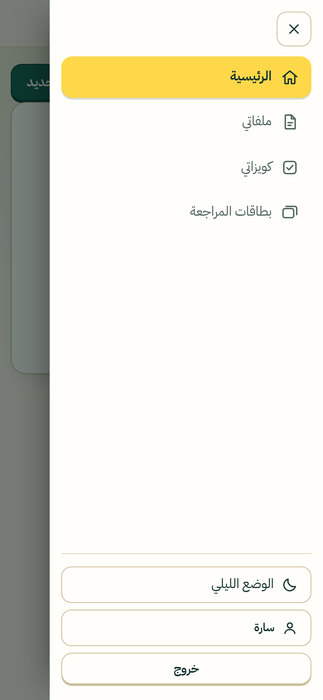
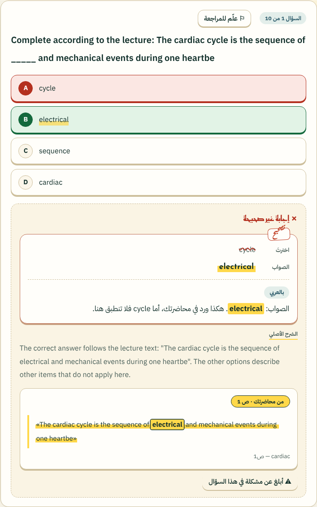
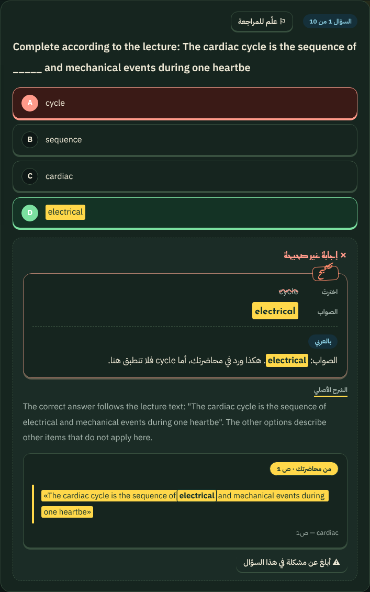
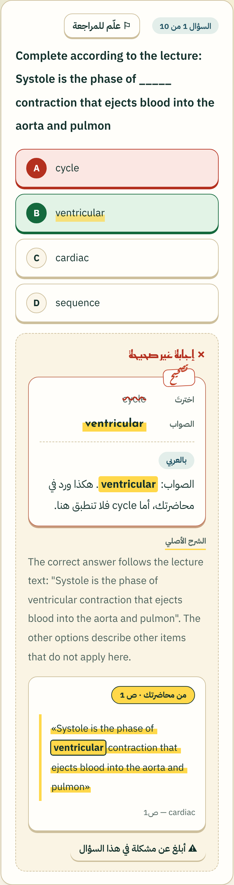

# نظام التصميم: «ورقة وقلم تمييز»

الفكرة: مكتب طالب. ورق دافئ، حبر زمردي عميق، وقلم تمييز أصفر. وعد المنتج الوحيد (كل سؤال معه السطر الذي أُخذ منه من محاضرتك) صار رمزه البصري: **قلم التمييز**. المبررات والبحث في [`DESIGN-RESEARCH.md`](DESIGN-RESEARCH.md). كل شيء في [`frontend/css/app.css`](../frontend/css/app.css) ويُعدَّل من المتغيرات في `:root`.


## لقطات (من الموقع نفسه بتدفق حقيقي)
| الصفحة التعريفية (لغير المسجَّل) | لوحة المستخدم (حاسوب) | لوحة المستخدم (جوال) | الحل: الدليل بطل الشاشة | الليلي |
|---|---|---|---|---|
|  |  |  |  |  |

القائمة الجانبية على الهاتف (درج): 

## الشعار
- **العلامة**: حرف **«ك»** (مأخوذ من خط IBM Plex Sans Arabic الغامق، رخصة SIL OFL) بلون الورق على شارة زمردية. الشرطة الصغيرة داخل الكاف — التي تجعل الكاف كافًا — استُبدلت بـ**علامة صح** بلون قلم التمييز الأصفر: «تم التحقق من محاضرتك». هي نفس فكرة المنتج في حرف واحد. ملفات: [`brand/logo-mark.svg`](brand/logo-mark.svg) و[`brand/logo-mark-on-dark.svg`](brand/logo-mark-on-dark.svg) (العلامة نفسها، لا تتغير في الوضع الليلي) و[`brand/favicon.svg`](brand/favicon.svg) (أيقونة التبويب، وهي نفسها مضمّنة في `index.html`).
- **اللوكب الكامل**: العلامة + «كويزي» بخط Reem Kufi، ولا شيء غيرهما (التوقيع خارج الشعار، انظر أدناه): [`logo-lockup.png`](brand/logo-lockup.png) و[`logo-lockup-on-dark.png`](brand/logo-lockup-on-dark.png) (شفافان). يُعاد توليدهما بـ`node scripts/render_brand.js`.
- **قواعد**: لا تُمدَّد العلامة ولا تُدار، ولا يتغيّر لون علامة الصح ولا شكل الكاف، والحدّ الأدنى للحجم ١٦ بكسل. التوقيع لا يُكتب بغير خط الرقعة ولا يصغر عن ١٣ بكسل.
- **التوقيع «أخوكم سعد مقبل» يظهر مرة واحدة فقط في الموقع، في مكان واحد وصغير وخارج الشعار**: سطر واحد في آخر كل صفحة (`<footer id="credit">`)، في وسط عمود المحتوى وفي مجرى الصفحة العادي: لا يثبت على الشاشة ولا يطفو ولا يغطي محتوًى أو زرًّا، ولا يدخل القائمة الجانبية ولا الشعار، ولا يُطبع. بحجم ٠٫٨٨rem (نحو ١٤ بكسل) بخط الرقعة وبلون المرجاني (الأفتح في الوضع الليلي). الصفحات القصيرة يبقى تذييلها في أسفل الشاشة (على الجوال أيضًا)، والطويلة في آخرها. كان تحت كلمة «كويزي» في الرأس فنُقل بطلب المستخدم: «مكان أصغر خارج عن اللوقو ولا يعيق على المستخدمين استخدام الموقع». لا يُكرَّر في أي مكان آخر ولا في الصفحة الرئيسية ولا في الوصف. يحرسه اختبار المتصفح (`run_web_operator.js` المشهد 3n): مرة واحدة في كل صفحة وعلى شاشات من ١٢٨٠ إلى ٣٢٠ بكسل، لا شيء منه في الرأس، أصغر من ١٦ بكسل، في المجرى العادي (`position:static`)، تحت محتوى الصفحة وداخل الشاشة، ولا زر ولا رابط تحته.

## ما تغيّر وما لم يتغيّر
التصميم وحده تغيّر. **التشغيل كما كان قبل إعادة التصميم**: في الرأس اسم الحساب (رابط «حسابي») وزر «خروج»، ولغير المسجَّل «دخول» و«إنشاء حساب»؛ وفي التنقل «ذكاء المشغل» حين يُفعَّل وضع المشغّل (على الجوال هو في الشريط السفلي مع بقية الروابط، لا يُقصّ ولا يخرج عن الشاشة حتى عرض ٣٢٠ بكسل)؛ الصفحة الرئيسية لغير المسجَّل هي نفس الصفحة التعريفية (لدي حساب / ابدأ مجانًا)، ولوحة المسجَّل نفسها (أهلًا فلان، كويز جديد، البطاقات الثلاث، حالة «ابدأ برفع أول ملف»)، ولافتة وضع الجهاز بنصها. يحرس ذلك اختبار المتصفح (`run_web_local.js` و`run_web_operator.js` المشهد 3n).

## الألوان (التباين محسوب: كل أزواج النص ≥ ٤٫٥:١)
| الدور | فاتح | ليلي | التباين (النص على الخلفية) |
|---|---|---|---|
| خلفية الصفحة / بطاقة | `#FBF6EA` / `#FFFEFA` | `#0E1816` / `#16251F` | الحبر على الورق ١٣٫١ · ليلي ١٤٫٩ |
| النص / النص الخافت | `#12302B` / `#4D625C` | `#EFE9D6` / `#A9B8B0` | الخافت ٦٫٠ على الورق · ٨٫٨ ليلًا |
| الإجراء الرئيسي | زمرد `#0F5D50` (نص `#FFFDF4`) | نعناع `#5FD8B8` (نص `#0B2420`) | ٧٫٦ · ٩٫٣ |
| قلم التمييز (الدليل والاختيار) | `#FFD84A` (نص `#12302B`) | نفسه | ١٠٫٢ |
| مرجاني (ختم/توقيع) | `#FF6B4A`؛ نصًا `#C2432A` | نصًا `#FF8A6B` | ٤٫٧ · ٧٫٨ |
| صحيح / خطأ / تنبيه | `#14693D` · `#B4301F` · `#7C4800` على أرضياتها الباهتة | ألوان فاتحة على أرضيات داكنة | ٥٫٧ – ٦٫٧ · ٧٫٦ – ٩٫٧ |

## الخطوط (مدمجة في الموقع، رخصة SIL OFL، لا طلب خارجي)
- **Reem Kufi** (٥٠٠/٧٠٠): العناوين والأرقام الكبيرة فقط.
- **IBM Plex Sans Arabic** (٤٠٠/٦٠٠/٧٠٠، عربي + لاتيني): كل النص والأسئلة. تباعد الأسطر ١٫٨–٢، ولا `letter-spacing` على العربية (يقطع وصل الحروف).
- **Aref Ruqaa** (٧٠٠): التوقيع فقط.
- الملفات في [`frontend/fonts`](../frontend/fonts) (نحو ٢٦٠ كيلوبايت)، وتُحمَّل بـ`unicode-range` فلا يُنزَّل لاتيني لصفحة عربية بحتة.

## المكوّنات
- **بطاقة (ورقة)**: حدّ ١٫٥ بكسل بلون الورق الغامق وظل ناعم؛ **زر** له حافة سفلية ٣ بكسل يضغطها اللمس («زر قابل للضغط»)؛ **شريحة الاختيار** صفراء عند التحديد؛ **شريط التقدم** مخطّط.
- **قلم التمييز** `.mk`: خط أصفر تحت الكلمات المهمة؛ `.mk.swipe` يرسمه عند تحميل الصفحة (من اليمين في العربية). في الوضع الليلي يصير تظليلًا كاملًا بحبر داكن حتى يبقى النص مقروءًا.
- **الدليل** `.evidence`: بطاقة «من محاضرتك · ص N» والسطر المقتبس مظلَّل — هي بطل شاشة الحل والنتيجة.
- **علامة الاختيار** (`input[type=checkbox]`): مربع بحدّ واضح، وعند التحديد يمتلئ بلون الإجراء الرئيسي وتظهر علامة صح (لا مربع النظام الذي يبدو أسود في الوضع الليلي). **منطقة الرفع** في «كويز جديد» تُظلَّل بحدّ زمردي عند سحب ملف فوقها.
- **شريحة الإجابة** `.opt`: حدّ سفلي ملموس؛ الصحيحة خضراء وتحتها تمييز، الخاطئة حمراء، المحدّدة صفراء.
- **ورقة التصحيح** `.fix` (عند الإجابة الغلط أو ترك السؤال فارغًا): كما يصحّح المعلّم ورقتك. بطاقة بحدّ أحمر خفيف وختم «تصحيح» مائل ثلاث درجات (خط الرقعة بلون المرجاني) على حافتها؛ سطر «اخترتَ» وفيه ما اخترتَه **مشطوبًا بخط أحمر متموّج** (`del`)؛ سطر «الصواب» وفيه الإجابة الصحيحة **بقلم التمييز** بخط Reem Kufi؛ ثم، إن وُجد ذكاء اصطناعي، خط متقطع وشارة «بالعربي» وتحتها **التصحيح بالعربية** (`.fx-ar`) يحفظ المصطلحات والإجابة الصحيحة بلغتها الأصلية وتُوسَم فيه الكلمة الصحيحة `mark.key` (أصفر مصمت بخط غليظ). تبقى الكلمة نفسها موسومة في جملة المحاضرة داخل `.evidence` (وبحلقة داكنة رفيعة حتى تتميّز في الوضع الليلي حيث الجملة كلها مظلّلة). تحتها «الشرح الأصلي» بلون هادئ إن كان شرح النموذج بلغة المحاضرة (لا تُكتب الشارة للشرح العربي). المكان المحجوز للتعريب لا يظهر إلا إن تأخر الجواب أكثر من ٤٥٠ مللي ثانية (لا وميض حين لا ذكاء اصطناعي)، وتتوقف حركته مع `prefers-reduced-motion`. كل ذلك يجتاز فحص axe في الفاتح والليلي والجوال.
    
- **الجداول الطويلة (الملفات والكويزات) على الهاتف**: يصير كل صف بطاقة صغيرة (العنوان، سطر تفاصيل بعناوينها، ثم الأزرار) بدل جدول عريض يدفع الأزرار خارج الشاشة؛ والكويزات تُعرض ٥٠ في كل مرة مع «عرض المزيد».
- **التنقل**: **قائمة عامودية على الجنب** (يمين الصفحة بالعربية): الشعار (العلامة و«كويزي» فقط) في أعلاها، ثم الروابط (الصفحة الحالية بقلم التمييز الأصفر)، وفي أسفلها الوضع الليلي واسم الحساب و«خروج». على الشاشات العريضة (> ٩٠٠ بكسل) هي دائمًا ظاهرة بعرض ٢٥٢ بكسل وتثبت أثناء التمرير. على الهاتف شريط علوي صغير (زر القائمة + الشعار) والقائمة نفسها **درج ينزلق من الجانب نفسه**: يُغلق بزر ✕ أو Esc أو لمسة خارجه أو اختيار رابط أو أي انتقال، وأثناء فتحه لا يخرج التركيز منه. أزرار ≥ ٤٤ بكسل.
- **الوضع الليلي**: تلقائي حسب النظام، وزر ☾/☀ يحفظ اختيارك في `localStorage` (`quizzy_theme`) دون وميض عند التحميل.

## الحركة وإمكانية الوصول
- الحركة قليلة (رسم التمييز، رفع الشعار قليلًا، قلب البطاقة) وتُلغى بـ`prefers-reduced-motion`.
- حلقة التركيز صفراء ثخينة مع هالة داكنة، ظاهرة على الفاتح والليلي. تخطَّ إلى المحتوى. `aria-current` للصفحة الحالية. الأيقونات مخفية عن قارئ الشاشة (`aria-hidden`) والنص موجود.
- الطباعة (PDF من زر الطباعة) تعود إلى أبيض وأسود بلا خلفيات.
- المتصفحات القديمة بلا `color-mix()` (بعض WebView) تأخذ لونًا سادة قبل اللون المحسَّن في كل موضع حرج، فلا يضيع نص ولا حدّ.

## إعادة توليد اللقطات والهوية
```bash
python3 static-edition/build.py /tmp/web-dist
node scripts/ui_shots.js /tmp/web-dist /tmp/cardiac.pdf /tmp/shots     # سطح المكتب والجوال والليلي، بتدفق حقيقي
node scripts/render_brand.js                                           # لوحة الهوية واللوكب
```
