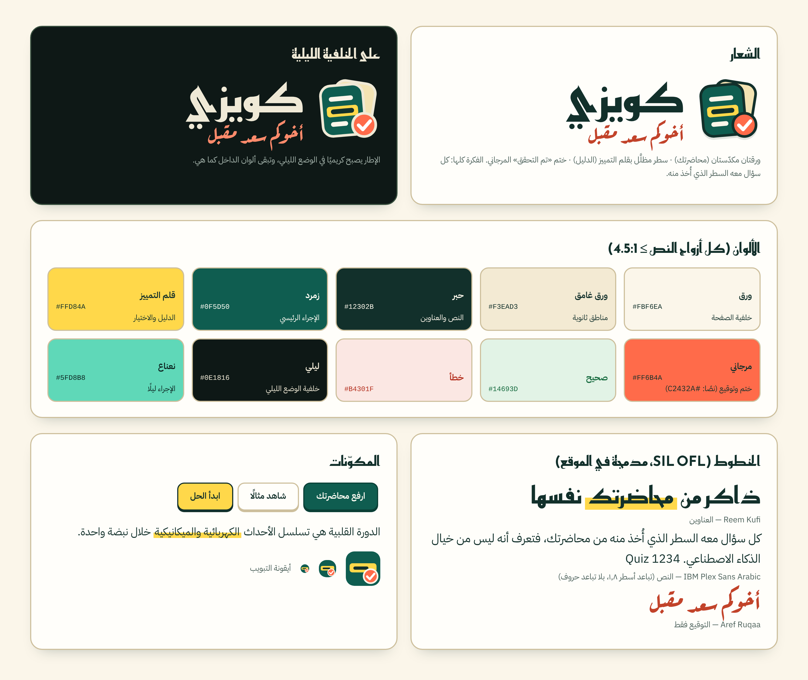

# نظام التصميم: «ورقة وقلم تمييز»

الفكرة: مكتب طالب. ورق دافئ، حبر زمردي عميق، وقلم تمييز أصفر. وعد المنتج الوحيد (كل سؤال معه السطر الذي أُخذ منه من محاضرتك) صار رمزه البصري: **قلم التمييز**. المبررات والبحث في [`DESIGN-RESEARCH.md`](DESIGN-RESEARCH.md). كل شيء في [`frontend/css/app.css`](../frontend/css/app.css) ويُعدَّل من المتغيرات في `:root`.



## الشعار
- **العلامة**: ورقتان مكدّستان (المحاضرة) + سطر مظلَّل بالأصفر (الدليل) + ختم مرجاني «تم التحقق». ملفات: [`brand/logo-mark.svg`](brand/logo-mark.svg) (على فاتح) و[`brand/logo-mark-on-dark.svg`](brand/logo-mark-on-dark.svg) (الإطار كريمي) و[`brand/favicon.svg`](brand/favicon.svg) (نسخة مبسّطة لأيقونة التبويب).
- **اللوكب الكامل**: العلامة + «كويزي» بخط Reem Kufi + التوقيع «أخوكم سعد مقبل» بخط Aref Ruqaa تحتها: [`logo-lockup.png`](brand/logo-lockup.png) و[`logo-lockup-on-dark.png`](brand/logo-lockup-on-dark.png) (شفافان). يُعاد توليدهما بـ`node scripts/render_brand.js`.
- **قواعد**: لا تُمدَّد العلامة ولا تُدار أكثر من ٨°، ولا يُغيَّر لون الختم المرجاني، والحدّ الأدنى للحجم ٢٤ بكسل (تحته استعمل الأيقونة المبسّطة). التوقيع لا يُكتب بغير خط الرقعة ولا يصغر عن ١٣ بكسل.
- **التوقيع «أخوكم سعد مقبل»** يظهر في ثلاثة أماكن فقط: تحت الشعار في الرأس، وفي ملاحظة الصفحة الرئيسية، وفي التذييل.

## الألوان (التباين محسوب: كل أزواج النص ≥ ٤٫٥:١)
| الدور | فاتح | ليلي | التباين (النص على الخلفية) |
|---|---|---|---|
| خلفية الصفحة / بطاقة | `#FBF6EA` / `#FFFEFA` | `#0E1816` / `#16251F` | الحبر على الورق ١٣٫١ · ليلي ١٤٫٩ |
| النص / النص الخافت | `#12302B` / `#4D625C` | `#EFE9D6` / `#A9B8B0` | الخافت ٦٫٠ على الورق · ٨٫٨ ليلًا |
| الإجراء الرئيسي | زمرد `#0F5D50` (نص `#FFFDF4`) | نعناع `#5FD8B8` (نص `#0B2420`) | ٧٫٦ · ٩٫٣ |
| قلم التمييز (الدليل والاختيار) | `#FFD84A` (نص `#12302B`) | نفسه | ١٠٫٢ |
| مرجاني (ختم/توقيع) | `#FF6B4A`؛ نصًا `#C2432A` | نصًا `#FF8A6B` | ٤٫٧ · ٧٫٨ |
| صحيح / خطأ / تنبيه | `#14693D` · `#B4301F` · `#7C4800` على أرضياتها الباهتة | ألوان فاتحة على أرضيات داكنة | ٥٫٧ – ٦٫٧ · ٧٫٦ – ٩٫٧ |

## الخطوط (مدمجة في الموقع، رخصة SIL OFL، لا طلب خارجي)
- **Reem Kufi** (٥٠٠/٧٠٠): العناوين والأرقام الكبيرة فقط.
- **IBM Plex Sans Arabic** (٤٠٠/٦٠٠/٧٠٠، عربي + لاتيني): كل النص والأسئلة. تباعد الأسطر ١٫٨–٢، ولا `letter-spacing` على العربية (يقطع وصل الحروف).
- **Aref Ruqaa** (٧٠٠): التوقيع فقط.
- الملفات في [`frontend/fonts`](../frontend/fonts) (نحو ٢٦٠ كيلوبايت)، وتُحمَّل بـ`unicode-range` فلا يُنزَّل لاتيني لصفحة عربية بحتة.

## المكوّنات
- **بطاقة (ورقة)**: حدّ ١٫٥ بكسل بلون الورق الغامق وظل ناعم؛ **زر** له حافة سفلية ٣ بكسل يضغطها اللمس («زر قابل للضغط»)؛ **شريحة الاختيار** صفراء عند التحديد؛ **شريط التقدم** مخطّط.
- **قلم التمييز** `.mk`: خط أصفر تحت الكلمات المهمة؛ `.mk.swipe` يرسمه عند تحميل الصفحة (من اليمين في العربية). في الوضع الليلي يصير تظليلًا كاملًا بحبر داكن حتى يبقى النص مقروءًا.
- **الدليل** `.evidence`: بطاقة «من محاضرتك · ص N» والسطر المقتبس مظلَّل — هي بطل شاشة الحل والنتيجة.
- **شريحة الإجابة** `.opt`: حدّ سفلي ملموس؛ الصحيحة خضراء وتحتها تمييز، الخاطئة حمراء، المحدّدة صفراء.
- **التنقل**: شريط علوي على الحاسوب (الصفحة الحالية بقلم التمييز)، وشريط **سفلي بالإبهام** على الهاتف (≤ ٧٢٠ بكسل)؛ أزرار ≥ ٤٤ بكسل.
- **الوضع الليلي**: تلقائي حسب النظام، وزر ☾/☀ يحفظ اختيارك في `localStorage` (`quizzy_theme`) دون وميض عند التحميل.

## الحركة وإمكانية الوصول
- الحركة قليلة (رسم التمييز، رفع الشعار قليلًا، قلب البطاقة) وتُلغى بـ`prefers-reduced-motion`.
- حلقة التركيز صفراء ثخينة مع هالة داكنة، ظاهرة على الفاتح والليلي. تخطَّ إلى المحتوى. `aria-current` للصفحة الحالية. الأيقونات مخفية عن قارئ الشاشة (`aria-hidden`) والنص موجود.
- الطباعة (PDF من زر الطباعة) تعود إلى أبيض وأسود بلا خلفيات.

## إعادة توليد اللقطات والهوية
```bash
python3 static-edition/build.py /tmp/web-dist
node scripts/ui_shots.js /tmp/web-dist /tmp/cardiac.pdf /tmp/shots     # سطح المكتب والجوال والليلي، بتدفق حقيقي
node scripts/render_brand.js                                           # لوحة الهوية واللوكب
```
